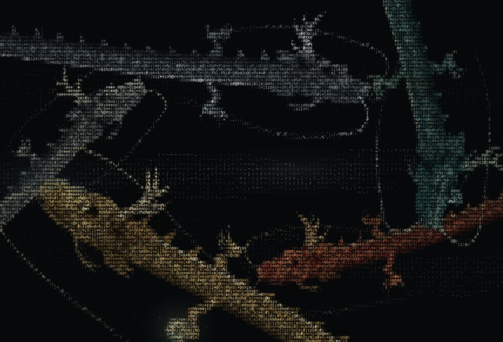

# 雲龍 Yunlong

**五條中國龍，穿行於字元構成的雲海。**

雲龍是一個以 Canvas、JavaScript 與字元渲染製作的即時動畫作品。創作靈感來自 [stackedlol/ascii-sharks](https://github.com/stackedlol/ascii-sharks)：把字元組成的游動生物，重新想像成騰雲飛行的中國龍，再融入**東方五行**與 **XYZ 三軸運動**。

[公開試看](https://poplolioi11.github.io/yunlong/) · [下載版本](https://github.com/poplolioi11/yunlong/releases) · [MIT 授權](LICENSE)



## 創作概念

### 從鯊魚到龍

ascii-sharks 的 Canvas 字元網格、分節身體跟隨、轉彎與尾流，提供了創作起點。雲龍重新實作龍頭、鹿角、前伸長鬚、五爪、鱗片、龍珠與分層雲氣，讓細長的身體仍能辨識為中國龍。它是受原作啟發的獨立改作，未把原作描述成現成的三維飛行系統。

### 東方五行

五龍以青、赤、黃（金色）、白、黑，分別對應木、火、土、金、水。開場依相生環序繞行約55秒，五龍的隔位關係對應相剋概念；隨後各自散入雲海。這是作品的色彩與動態編排。

| 龍 | 五行 | 色彩 |
| --- | --- | --- |
| 青龍 | 木 | 青綠、碧色 |
| 紅龍 | 火 | 朱紅、赭紅 |
| 金／黃龍 | 土 | 暗金、亮金 |
| 白龍 | 金 | 銀白、暖白 |
| 黑龍 | 水 | 墨灰、銀灰邊光 |

### 三軸飛行與巨物慣性

龍在實際 XYZ 座標中移動，身軀沿飛行歷史分節跟隨，再透視投影成字元。轉向、俯仰與側滾都具有慣性：可以朝視角游近、從畫面上方掠過，也可以遠遊淡出，幾分鐘後再逐漸回來。牠們不必一直完整出現在畫面裡。

亮雲與暗雲會影響龍身的顏色，前景雲遮住部分身體；四周偶爾浮現金、暗金、青銅與銅色的直角回形雲紋。金龍握有帶刻紋及微光的龍珠。畫面保持純動畫，沒有標題、按鈕或控制列。

## 歡迎各式使用

本作品以 **MIT License** 開源，歡迎用於個人作品、教學、網站背景、直播、藝術展演、動態桌布、螢幕保護程式與商業專案，也歡迎修改、再散布及衍生創作。使用與散布時，請依 MIT 條款保留著作權及授權聲明；原作致謝亦隨程式保留。

如果你改成新的神獸、不同的字元風格，或適配桌布／展示系統，歡迎分享成果或提出改進。

## 執行方式

這是一個無框架、無外部執行期依賴的靜態網頁專案，正式網頁檔案在 `dist/`。不需要安裝 npm 套件或執行打包。

1. 下載並解壓縮專案，或複製此儲存庫。
2. 在專案根目錄啟動本機靜態伺服器：

   ```sh
   python3 -m http.server 4322 --bind 127.0.0.1 --directory dist
   ```

3. 使用現代瀏覽器開啟 `http://127.0.0.1:4322/`。

也可以把 `dist/` 內的全部檔案上傳到支援靜態網頁的主機。請透過 HTTP／HTTPS 執行，JavaScript 模組不適合直接雙擊 HTML 後以 `file://` 開啟。

移動游標或輕觸會輕微牽動風向。系統啟用「減少動態效果」時，作品會靜止；分頁隱藏時暫停更新。

### 桌布與螢幕保護程式

網頁程式可作為支援網頁內容的桌布或螢幕保護程式之素材，但此版本尚未附 Windows／macOS 安裝包，也未完成特定桌布工具的相容性驗收。錄成影片或擷取圖片也可依 MIT 授權使用；影片播放將沿用錄製的固定內容。

## 開發與驗證

JavaScript 使用原生 ES modules；運動測試需 Node.js 18 或更新版本。

```sh
npm run check
npm test
```

未安裝 npm 時，也可直接執行 `node scripts/verify-flight.mjs`。測試以兩種畫面尺寸模擬五龍運動，核對三軸骨架、慢轉限制、近鏡／上緣掠過、淡出回返與尺寸改變後的有效性。

| 檔案 | 功能 |
| --- | --- |
| `dist/flight.js` | 三維軌跡、五行開場、慣性與分節跟隨 |
| `dist/dragon.js`、`dist/dragon-head.js` | 龍形與字元渲染、立體五官、五爪與龍珠 |
| `dist/clouds.js`、`dist/motifs.js` | 雲氣、雲光與四周回形紋樣 |
| `dist/app.js` | 畫面整合、輸入與播放生命週期 |

採固定相機與程序化立體部件，交叉幾何使用部件中心的深度排序。運動模擬測試不等於長時間瀏覽器幀率測試；目前未完成跨瀏覽器、手機真機及所有桌布平台的全面驗收。

## 作者、協作與來源

曲宸宇（Chu, Chen-Yu；GitHub：[poplolioi11](https://github.com/poplolioi11)）發想、提出美術與動態方向並委託實作；程式與測試由 AI 協作完成。發布的作品與來源說明由主代理整合核對。

- 概念啟發：[stackedlol/ascii-sharks](https://github.com/stackedlol/ascii-sharks)，讀取版本 `a0074c16a106f0abc665fe9712ca445f8f98ad8e`。原作作者與 MIT 條款保留於 [NOTICE.txt](dist/NOTICE.txt)。
- 面部氣氛參考：國立故宮博物院[《神龍沛雨圖》展覽頁](https://theme.npm.edu.tw/MythicalCreatures115/page-3)（館方傳宋陳容名下作品），取眉眼、鼻吻與鬚的氣氛，並非精確臨摹。館藏影像未包含於專案。
- 回形雲紋為本作品新繪裝飾，受使用者指定的古代青銅器紋樣氣氛啟發，未宣稱精確復原某件三星堆文物。

## 授權

Copyright © 2026 Chen-Yu Chu（曲宸宇）。本專案採 [MIT License](LICENSE)。無須因商業用途另行購買授權；詳細權利、保留聲明與免責條款以 LICENSE 為準。
